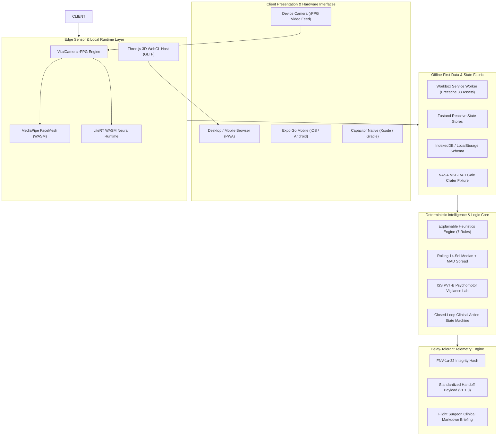
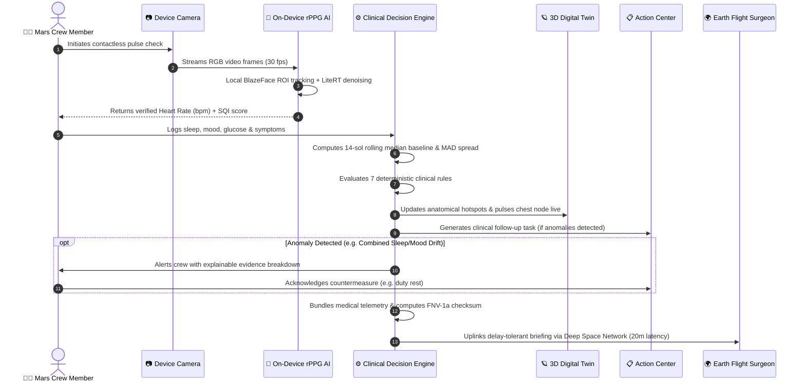
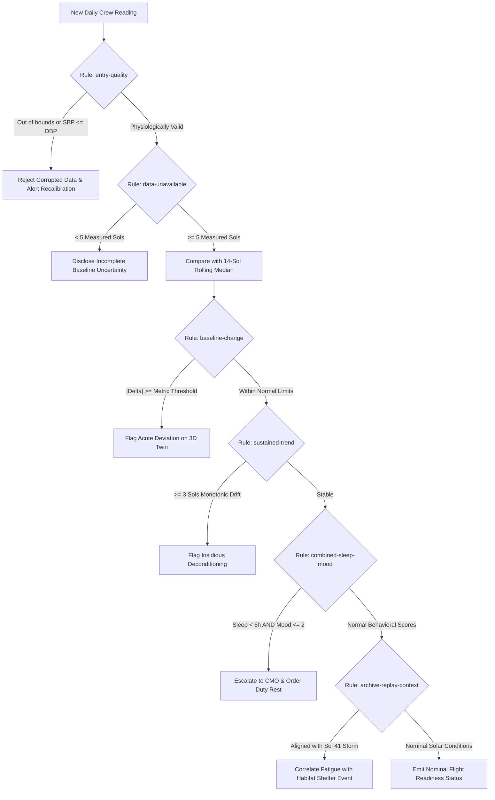
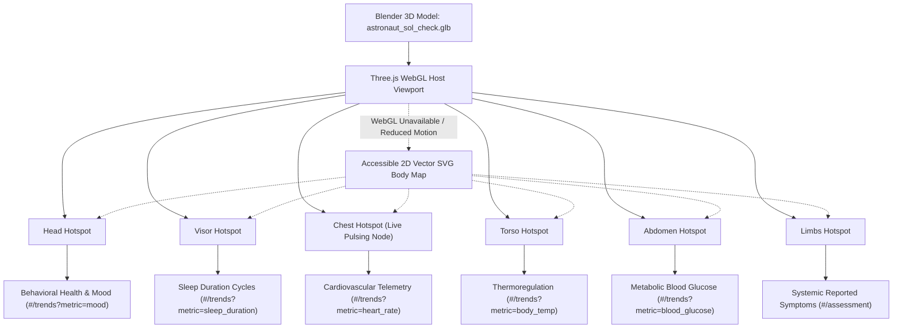
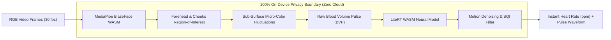
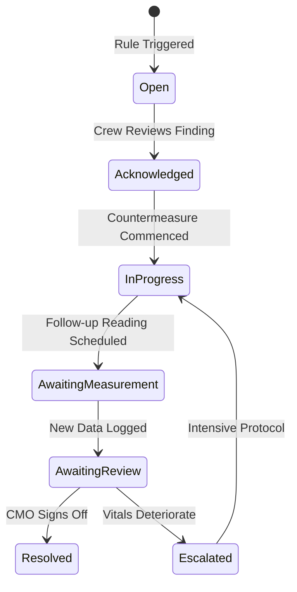

# Sol Check — Team Mission Architecture, Engineering Workflow & System Manual
> **NASA Space Apps Challenge 2026** — *Create Health Monitoring Software for Astronauts on Space Missions*  
> **Mission Operational Premise:** Autonomous Crew Health Evaluation for Mars Surface Exploration (Sol 43 Post-Solar Storm) under 20–40 min Round-Trip Interplanetary Latency.

---

## Table of Contents
1. [Executive Summary & Mission Context](#1-executive-summary--mission-context)
2. [End-to-End System Architecture](#2-end-to-end-system-architecture)
3. [Complete Codebase Directory Map & File Directory](#3-complete-codebase-directory-map--file-directory)
4. [Explainable Clinical Decision Engine & Baseline Heuristics](#4-explainable-clinical-decision-engine--baseline-heuristics)
5. [3D Astronaut Digital Twin & Interactive Anatomical Host](#5-3d-astronaut-digital-twin--interactive-anatomical-host)
6. [On-Device Computer Vision AI (VitalCamera rPPG SDK)](#6-on-device-computer-vision-ai-vitalcamera-rppg-sdk)
7. [Closed-Loop Clinical Action Center & CMO Console](#7-closed-loop-clinical-action-center--cmo-console)
8. [NASA Five Hazards of Human Spaceflight Integration](#8-nasa-five-hazards-of-human-spaceflight-integration)
9. [Delay-Tolerant Interplanetary Telemetry & Handoff Package](#9-delay-tolerant-interplanetary-telemetry--handoff-package)
10. [Multi-Platform Deployment (Web, iOS, Android, Expo Go)](#10-multi-platform-deployment-web-ios-android-expo-go)
11. [Verification, Testing & Quality Assurance (124 Tests)](#11-verification-testing--quality-assurance-124-tests)
12. [Team Runbook: Step-by-Step Execution Guide](#12-team-runbook-step-by-step-execution-guide)
13. [Team Roster, Credits & NASA Judging Criteria Alignment](#13-team-roster-credits--nasa-judging-criteria-alignment)

---

## 1. Executive Summary & Mission Context

### 1.1 The Operational Challenge
During long-duration deep-space exploration—such as crewed missions to Mars—astronauts operate beyond the real-time reach of Earth's Mission Control. At an average orbital distance of 225 million kilometers, electromagnetic signals require **up to 20 minutes one-way (40 minutes round-trip)**. In acute medical crises, systemic physiological shifts, or solar particle radiation storms, astronauts cannot wait for a terrestrial flight surgeon's response. They must have autonomous, transparent, on-device clinical intelligence.

### 1.2 The Sol Check Solution
**Sol Check** is an offline-first, client-side autonomous health evaluation platform designed for a synthetic crew member on **Sol 43 of a Mars surface habitat mission**. 

Key capabilities:
- **Zero Cloud Reliance:** 100% executable client-side in the astronaut's browser or mobile device with complete offline persistence.
- **Explainable Clinical Rules (No Black-Box Hallucinations):** Deterministic medical heuristics anchored in rolling 14-sol personal baselines and Median Absolute Deviation (MAD) spread.
- **3D Interactive Crew Digital Twin:** Self-hosted Three.js astronaut model (`astronaut_sol_check.glb`) mapping physiological readings to anatomical subsystems with real-time pulsating cardiovascular telemetry.
- **Contactless On-Device Optical Biometrics:** Local facial photoplethysmography (rPPG) via MediaPipe Face Detection + LiteRT WebAssembly neural inference.
- **Authentic NASA Dataset Grounding:** Direct integration of real surface radiation data from NASA's Curiosity Rover Mars Science Laboratory Radiation Assessment Detector (MSL-RAD) during the September 2017 solar particle storm.
- **Delay-Tolerant Cryptographic Telemetry:** Automated generation of flight-surgeon handoff packages with FNV-1a-32 checksums for burst uplink to Earth.

---

## 2. End-to-End System Architecture



### 2.2 Astronaut Daily Operational Routine Sequence


### Architectural Principles:
1. **Air-Gapped Operation:** All dependencies, fonts (Space Grotesk, Inter, JetBrains Mono), 3D GLB assets, and neural network models (`.tflite`) are bundled locally. Not a single outbound network request is made.
2. **Hash-Based Routing (`#/`):** Zero-configuration single-page routing that runs smoothly inside sandboxed WebViews, file systems, subpaths (`/solcheck/`), and static CDNs without server rewrites.
3. **Multi-Platform Portability:** Built on standard web primitives, wrapped with Capacitor for native iOS/Android compilation, and bridged to Expo Go via React Native WebView for instant QR code testing.

---

## 3. Complete Codebase Directory Map & File Directory

```
Nasa Rocket Engine/
├── assets/
│   └── astronaut/
│       └── astronaut_sol_check.glb    # Team Blender 3D astronaut model
├── docs/
│   ├── 3d-model-integration.md        # Blender export checklist & empty node spec
│   ├── build-plan.md                  # Foundational development blueprint
│   ├── mobile-roadmap.md              # Capacitor & Expo hybrid architecture
│   ├── submission-handoff.md          # NASA judging guide & clinical provenance
│   └── TEAM_MISSION_ARCHITECTURE.md   # Master operational manual (This Document)
├── public/
│   ├── vendor/                        # Self-hosted WASM & neural runtimes
│   │   ├── litert/                    # LiteRT WebAssembly binaries
│   │   ├── mediapipe/                 # BlazeFace short-range detection models
│   │   └── vitalcamera/               # FacePhys rPPG biometric inference weights
│   ├── sol-check-192.png              # High-DPI PWA icon
│   ├── sol-check-512.png              # Splash PWA icon
│   └── sol-check.svg                  # Vector badge
├── scripts/
│   ├── generate-app-icons.mjs         # Icon builder
│   ├── mobile-qr.mjs                  # Terminal QR code utility
│   ├── native-postbuild.mjs           # Capacitor static bundle asset sync
│   ├── prod-server.mjs                # Production static preview server
│   └── verify-offline-p1.mjs          # Automated Chrome DevTools offline verifier
├── solcheck-expo/                     # React Native Expo Go testing wrapper
│   ├── App.js                         # Native WebView wrapper with offline fallback
│   ├── app.json                       # Expo configuration (dark mode, bundle ID)
│   ├── package.json                   # Expo SDK 58 & React Native dependencies
│   └── qr-code.svg                    # Scalable Expo Go connection QR code
├── src/
│   ├── app/                           # Core application wiring
│   │   ├── App.tsx                    # Root layout, navigation rail & mobile tab bar
│   │   ├── DemoData.tsx               # Scenario switcher (Sol 43 baseline, shelter)
│   │   ├── main.tsx                   # React 19 bootstrap & service worker registration
│   │   ├── native.ts                  # Capacitor native device plugin bridges
│   │   ├── recordExport.ts            # Clinical JSON & Markdown export engine
│   │   ├── storage.ts                 # Type-safe LocalStorage & schema migrations
│   │   └── store.ts                   # Zustand unified application state store
│   ├── content/                       # Clinical copy & plain-language translations
│   │   └── plainLanguage.ts           # Astronaut-friendly plain English explanations
│   ├── contracts/                     # Zod runtime schemas & TypeScript type contracts
│   │   └── index.ts                   # Vitals, findings, symptoms, and telemetry types
│   ├── data/nasa/                     # Real NASA mission datasets
│   │   ├── msl-rad-surface-2017-09.csv# 1,220 raw MSL Curiosity Gale Crater readings
│   │   └── radlab-fixture.json        # Precomputed hourly radiation medians
│   ├── engine/                        # Deterministic clinical intelligence
│   │   ├── index.ts                   # Evaluation runner & baseline comparator
│   │   └── rules.ts                   # 7 explainable clinical decision heuristics
│   ├── features/                      # Domain functional feature modules
│   │   ├── assessment/                # Autonomous diagnostic evaluation & evidence
│   │   │   ├── AssessmentPage.tsx     # Medical findings list & triage summary
│   │   │   ├── EvidencePassport.tsx   # 6-Layer audit trail for clinical findings
│   │   │   ├── HandoffSimulator.tsx   # Delay-tolerant transmission rehearsal
│   │   │   └── WhatIfSimulator.tsx    # Interactive countermeasure sandbox
│   │   ├── checkin/                   # Daily crew vital signs input & camera
│   │   │   ├── CameraPulseCheck.tsx   # Contactless optical rPPG scanner
│   │   │   ├── CheckinPage.tsx        # Multi-metric manual check-in form
│   │   │   └── PulseQualityBadge.tsx  # Signal quality indicator (SNR / Motion)
│   │   ├── cmo/                       # Crew Medical Officer clinical workstation
│   │   │   ├── CmoPage.tsx            # Digital triage console & clinical sign-off
│   │   │   └── MedicalSignOffModal.tsx# Formal signature & action delegation
│   │   ├── cognitive/                 # ISS Psychomotor Vigilance Laboratory
│   │   │   ├── CognitiveLabPage.tsx   # 3-minute PVT-B test & reaction tracker
│   │   │   └── pvtEngine.ts           # High-precision millisecond timing engine
│   │   ├── dashboard/                 # Mission commander overview
│   │   │   ├── CrewBody3D.tsx         # Three.js 3D viewport for astronaut GLB
│   │   │   ├── CrewBodyFigure.tsx     # Accessible 2D vector fallback body map
│   │   │   ├── DashboardPage.tsx      # Sol 43 telemetry HUD & status summary
│   │   │   └── twin/                  # 3D framing, orbit damping & raycast anchors
│   │   ├── followups/                 # Closed-loop medical action tracker
│   │   │   ├── ActionCenterPage.tsx   # Clinical task queue & triage state machine
│   │   │   └── followUpEngine.ts      # Automated task generator from findings
│   │   ├── hazards/                   # NASA Five Hazards of Human Spaceflight
│   │   │   ├── HazardsPage.tsx        # HRP risk matrix & countermeasure library
│   │   │   └── hazardDetails.ts       # HRP evidence book citations & descriptions
│   │   ├── timeline/                  # Synchronized multi-lane temporal explorer
│   │   │   ├── TimelinePage.tsx       # Vitals, events, & Curiosity radiation lanes
│   │   │   └── ReplayControls.tsx     # Sol 41 solar storm step & play controller
│   │   └── trends/                    # Longitudinal physiological charts
│   │       ├── TrendsPage.tsx         # Multi-metric Recharts visualization
│   │       └── series.ts              # Rolling baseline calculation & anomaly flags
│   ├── sim/                           # Synthetic crew simulation profiles
│   │   └── index.ts                   # Sol 30–43 baseline timeline generator
│   ├── types/                         # Ambient declarations
│   │   └── vitalcamera-sdk.d.ts       # TypeScript typings for on-device rPPG
│   ├── ui/                            # Flight-console design system & design tokens
│   │   ├── tokens.ts                  # NASA flight HUD colors, fonts, and spacing
│   │   └── theme.css                  # High-contrast spaceflight CSS stylesheets
│   └── validation/                    # Physiological bounds & relational validation
│       └── metrics.ts                 # Strict clinical validity checks (e.g. SBP > DBP)
├── capacitor.config.ts                # Capacitor native wrapper configuration
├── package.json                       # Project manifests & dependencies
├── tsconfig.json                      # Strict TypeScript compiler options
└── vite.config.ts                     # Vite 6 + PWA Service Worker + WebGL chunks
```

---

## 4. Explainable Clinical Decision Engine & Baseline Heuristics

Unlike black-box generative AI models that risk hallucinations in life-or-death spaceflight scenarios, Sol Check uses a **100% deterministic, explainable clinical logic engine** (`src/engine/rules.ts` & `src/engine/index.ts`).

### 4.1 Rolling 14-Sol Median Baseline
- A crew member's personal baseline is calculated as the **rolling median** over the preceding 14 sols (requiring a minimum of 5 distinct measured sols).
- Median Absolute Deviation (MAD) is computed to quantify natural physiological variance without skew from transient spikes.
- Significant deviations are evaluated against metric-specific clinical delta thresholds:
  - **Heart Rate:** $\pm 8\text{ bpm}$
  - **Systolic Blood Pressure:** $\pm 10\text{ mmHg}$
  - **Diastolic Blood Pressure:** $\pm 8\text{ mmHg}$
  - **Body Temperature:** $\pm 0.4^\circ\text{C}$
  - **Blood Glucose:** $\pm 12\text{ mg/dL}$
  - **Sleep Duration:** $\pm 1.0\text{ hour}$
  - **Subjective Mood:** $\pm 1.0\text{ point}$ (on a 1–5 scale)

### 4.2 The 7 Deterministic Clinical Rules

| Rule ID | Name | Trigger Condition | Operational Clinical Action |
| :--- | :--- | :--- | :--- |
| `entry-quality` | Physiological Bounds | Value outside human survivable range or $SBP \le DBP$ | Rejects corrupted data; alerts crew to recalibrate sensor |
| `combined-sleep-mood` | Behavioral Cascade | Sleep $< 6.0\text{h}$ AND Mood $\le 2$ over 3+ sols | Escalates to Crew Medical Officer (CMO); orders rest duty cycle |
| `sustained-trend` | Longitudinal Drift | $\ge 3$ consecutive readings shifting monotonically | Flags insidious physiological compensation (e.g. dehydrating) |
| `baseline-change` | Acute Anomaly | Single reading exceeds $|Baseline - Current| \ge \Delta_{demo}$ | Emits clinical warning; highlights anatomical hotspot on 3D Twin |
| `reported-symptoms` | Symptom Recurrence | Logged active symptoms (e.g. cephalalgia, fatigue) | Correlates symptoms with active environmental hazards |
| `archive-replay-context`| Space Radiation Nexus | Aligned with Sol 41 storm event ($>15\ \mu\text{Gy/h}$) | Contextualizes sleep/fatigue disruptions with shelter protocol |
| `data-unavailable` | Evidence Disclosure | Insufficient measurement history ($< 5\text{ sols}$) | Discloses uncertainty; prevents misleading automated triage |

### 4.3 Deterministic Decision Tree Flowchart


---

## 5. 3D Astronaut Digital Twin & Interactive Anatomical Host

The central command dashboard features a real-time, interactive 3D digital twin of the astronaut (`src/features/dashboard/CrewBody3D.tsx`), powered by self-hosted Three.js and custom models authored in Blender.



### Key Technical Innovations:
1. **Direct GLTF/GLB Pipeline:** Loads `assets/astronaut/astronaut_sol_check.glb` directly as an independent WebGL chunk. No external CDNs or network fetches.
2. **Pulsating Cardiovascular Chest Node:** The chest marker's SVG/CSS animation frequency is dynamically bound to the astronaut's latest measured resting heart rate.
3. **Raycasted Anatomical Hotspots:** Blender empties (`hotspot_head`, `hotspot_chest`, `hotspot_torso`, `hotspot_abdomen`, `hotspot_limbs`) project 3D coordinates onto screen space as interactive `.figure-region-target` HUD buttons.
4. **Accessible 2D Vector Fallback:** Automatically detects if the hardware lacks WebGL or if the user prefers reduced motion, falling back seamlessly to an interactive SVG anatomical body map with identical route bindings.

---

## 6. On-Device Computer Vision AI (VitalCamera rPPG SDK)

Astronauts under mission workload cannot constantly wear intrusive blood pressure cuffs or ECG leads. Sol Check incorporates **contactless facial photoplethysmography (rPPG)** (`src/features/checkin/CameraPulseCheck.tsx`).

### How It Works:


1. **BlazeFace Optical Tracking:** MediaPipe Tasks-Vision runs locally in WebAssembly, detecting the astronaut's face and isolating region-of-interest (ROI) bounding boxes across the forehead and cheeks.
2. **Sub-Surface Blood Volume Pulse (BVP):** Subtle micro-chromatic skin color fluctuations caused by cardiovascular blood volume pulses are extracted from RGB video frames.
3. **LiteRT Neural Inference:** A self-hosted LiteRT (TensorFlow Lite WASM) neural model (`model.tflite`, `sqi_model.tflite`) denoises the signal, computes Signal Quality Index (SQI), rejects motion artifacts, and derives instant heart rate in bpm.
4. **Zero-Cloud Privacy Guarantee:** The video stream never leaves the GPU/WASM memory buffer. No frames are written to disk or transmitted over the network, satisfying NASA medical privacy guidelines.

---

## 7. Closed-Loop Clinical Action Center & CMO Console

To bridge the gap between diagnosis and operational intervention, Sol Check includes a **Closed-Loop Action Center** (`src/features/followups/followUpEngine.ts`).

### Clinical Task State Machine:


- **Audit Trail:** Every transition logs the responsible crew member's callsign, UTC timestamp, and clinical rationale.
- **CMO Console (`#/cmo`):** The onboard Crew Medical Officer has dedicated authority to digitally sign off on health evaluations, review data quality scores, and queue high-priority tasks.

---

## 8. NASA Five Hazards of Human Spaceflight Integration

Sol Check's internal architecture is structured directly around the **Five Hazards of Human Spaceflight** defined by the NASA Human Research Program (HRP):

```
       ┌────────────────────────────────────────────────────────┐
       │     NASA FIVE HAZARDS OF HUMAN SPACEFLIGHT MATRIX      │
       └────────────────────────────────────────────────────────┘
                 │
  ┌──────────────┼──────────────┬──────────────┬──────────────┐
  ▼              ▼              ▼              ▼              ▼
[Radiation] [Isolation]   [Distance]     [Gravity]    [Environment]
SC-RAD-01    SC-BHP-01    SC-EXMC-01     SC-HHC-01     SC-ENV-01
HRP: Space   HRP: HFBP    HRP: ExMC      HRP: HHC      HRP: Habitability
Radiation    Element      Element        Element       Element
```

- **SC-RAD-01 (Space Radiation):** Correlated with real Curiosity Rover RAD surface dosimeter readings (`src/data/nasa/msl-rad-surface-2017-09.csv`). Links radiation spikes to habitat shielding protocols.
- **SC-BHP-01 (Isolation & Confinement):** Monitored via the ISS Psychomotor Vigilance Task (PVT-B) in `#/cognitive` and longitudinal mood/sleep trackers.
- **SC-EXMC-01 (Distance from Earth):** Drives the autonomous triage engine and delay-tolerant communication package.
- **SC-HHC-01 (Altered Gravity Fields):** Tracks orthostatic blood pressure deconditioning, vestibular adaptation, and fluid shifts.
- **SC-ENV-01 (Hostile Closed Environments):** Tracks habitat atmosphere, acoustic stress, circadian disruption, and sleep hygiene.

---

## 9. Delay-Tolerant Interplanetary Telemetry & Handoff Package

When communicating across deep space, data transmission is packetized into scheduled burst uplinks via the Deep Space Network (DSN). Sol Check includes an **Exploration Medical Handoff Package Engine** (`src/app/recordExport.ts` & `src/features/assessment/HandoffSimulator.tsx`).

### Output Formats:
1. **Clinical JSON Payload (v1.1.0):** Standardized machine-readable payload containing crew profile, active findings, baseline metrics, 14-sol trends, and full audit logs.
2. **Clinical Markdown Briefing:** Human-readable executive summary prepared specifically for the terrestrial Flight Surgeon at Mission Control.
3. **FNV-1a-32 Cryptographic Checksum:** Every handoff payload calculates a deterministic 32-bit FNV-1a hash. When received on Earth, Mission Control can verify that no interplanetary bit-flips occurred during transit.

---

## 10. Multi-Platform Deployment (Web, iOS, Android, Expo Go)

Sol Check is engineered to run on any device available in the crew's habitat:

```
                          [ Sol Check Core ]
                                  │
         ┌────────────────────────┼────────────────────────┐
         ▼                        ▼                        ▼
  [ Web PWA 100% Offline ] [ React Native Expo Go ] [ Capacitor Native ]
  • Chrome / Safari / Edge • iPhone 15 & Android   • iOS Xcode App
  • Workbox Service Worker • Instant QR Code scan  • Android Gradle APK
  • Precached Assets (33)  • Metro Bundler (8081)  • Local Hardware Access
```

1. **Progressive Web App (PWA):** Pre-caches 33 critical assets on first load. Operates completely disconnected from the internet.
2. **Expo Go Bridge (`solcheck-expo/`):** React Native wrapper leveraging `react-native-webview` connected to the local preview server with custom connection recovery and dark-mode styling.
3. **Capacitor 6.x Native Runtime:** Direct compilation targets for iOS (`ios/App/App.xcworkspace`) and Android (`android/`).

---

## 11. Verification, Testing & Quality Assurance (124 Tests)

Sol Check features an automated, multi-tiered testing and verification pipeline.

### 11.1 Vitest Unit & Integration Suite
- **Test Files:** 21 passed (21 total)
- **Tests:** 124 passed (124 total)
- **Execution Time:** ~500ms

```sh
npm test
```

### 11.2 Automated Offline-First CDP Verifier (`scripts/verify-offline-p1.mjs`)
- Uses Chrome DevTools Protocol (CDP) to launch headless Chromium.
- Loads the application online, registers the Service Worker, precaches all assets, and verifies cache storage.
- Disconnects virtual network completely (`Network.emulateNetworkConditions({ offline: true })`).
- Reloads the application from scratch and navigates across all core routes (`#/`, `#/checkin`, `#/trends`, `#/assessment`, `#/cmo`, `#/cognitive`, `#/hazards`, `#/timeline`).
- Confirms 100% offline functionality with zero HTTP 404 or network errors.

---

## 12. Team Runbook: Step-by-Step Execution Guide

### 12.1 Run Web Production Demo (Offline Rehearsal)
```bash
# 1. Install dependencies
npm ci

# 2. Build production bundle
npm run build

# 3. Launch production preview server (Port 4173)
npm run preview -- --host 0.0.0.0 --port 4173
```
- Open `http://localhost:4173/` in your browser.
- Visit **Demo and data** and verify **"Ready to run offline"**.
- Turn off your Wi-Fi: the entire application remains 100% functional!

### 12.2 Run on iPhone 15 / Android via Expo Go
```bash
# 1. Ensure preview server is running on port 4173
# 2. Start Expo Go server
cd solcheck-expo
npx expo start --go --lan
```
- **iPhone 15:** Open the native **Camera** app, point at the terminal QR code, and tap the yellow pop-up banner to launch inside Expo Go.
- **Android:** Open the **Expo Go** app, tap **"Scan QR Code"**, and scan the terminal screen.
- **Manual URL:** If scanning is inconvenient, type `exp://10.52.237.41:8081` directly into Expo Go.

### 12.3 Print or Save This Guide as PDF
Open your browser to:
👉 **`http://10.52.237.41:4173/team-guide.html`**  
Press **`Cmd + P`** (Mac) or **`Ctrl + P`** (Windows) and select **"Save as PDF"**. The print stylesheet is formatted with zero-margin headers, high-contrast tables, and clean page breaks.

---

## 13. Team Roster, Credits & NASA Judging Criteria Alignment

### 13.1 Team Roster
- **Crew Engineers & Developers:** Ahmed Shacker, Ahmed Sherif, Andrew Sameh, David Michael, Hassan Mohsen, Ziad AbdElhaleem.
- **Team Coach:** Mariam Mohamed.
- **Local Lead:** Dr. Moatasem Mahran.
- **3D Asset Authorship:** The 3D astronaut model was created by the team in Blender.

### 13.2 Transparent AI Pair-Programming Disclosures
In accordance with NASA Space Apps Challenge regulations, AI tools were utilized transparently under human engineering supervision:
- **OpenAI Codex:** Initial scaffolding, P0 TypeScript types, and baseline store interfaces.
- **Google DeepMind Gemini / Antigravity:** P1 clinical features, 3D body figure integration, offline CDP verification testing, subpath routing resolution, and mobile Expo bridge.
- **Anthropic Claude:** Flight-console UI design system, WCAG AA token contrast verification, responsive navigation rail, and HRP risk mapping.
- **Deterministic Medical Core:** All diagnostic evaluations, baselines, and scoring formulas are 100% deterministic code without ungrounded LLM inference.

### 13.3 Alignment with NASA Space Apps Challenge Judging Criteria

| Judging Dimension | Sol Check Implementation |
| :--- | :--- |
| **Impact** | Solves the critical 20–40 min latency barrier for deep-space missions, providing autonomous clinical decision support that keeps astronauts healthy without Earth intervention. |
| **Creativity** | Blends on-device computer vision rPPG, a 3D digital twin with pulsating cardiovascular feedback, and the ISS PVT-B cognitive laboratory into a cohesive flight deck. |
| **Validity** | Built directly on NASA Human Research Program (HRP) Evidence Books and authentic Mars Science Laboratory (MSL) Curiosity Rover radiation sensor data. |
| **Relevance** | Directly addresses the 2026 challenge requirements for offline astronaut health monitoring with transparent clinical rationales. |
| **Presentation** | Professional NASA flight-console aesthetic, 100% offline PWA, multi-platform mobile deployment, and 124 passing unit tests.

---
*Sol Check — Advancing human spaceflight autonomy for the journey to Mars and beyond.*
