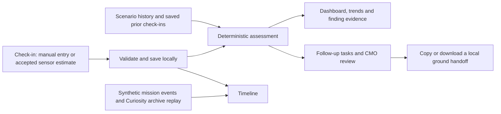

# Sol Check team architecture and workflow

Sol Check is an offline-first crew health monitoring prototype built around a simulated Mars mission. Its main workflow is check-in, personal-baseline comparison, evidence review, follow-up and a local handoff for delayed ground review.

## Data flow



| Component | Implementation |
| --- | --- |
| Application | React and TypeScript static SPA with hash routes. Vite builds desktop and mobile web bundles. Zustand holds mission and follow-up state. |
| Data contracts and storage | [Zod contracts](../src/contracts/index.ts) validate records. The [storage repository](../src/app/storage.ts) persists mission state in browser local storage. Scenario records, tasks and vigilance results are scoped to the active demo. |
| Synthetic mission | The [scenario fixtures](../src/scenarios/index.ts) provide Sol 43, routine and bad-entry cases. The default mission starts its interactive flow on Sol 43. |
| Local assessment | The [engine](../src/engine/index.ts) compares eligible observations with the crew member's history. The [rule definitions](../src/engine/rules.ts) pair conditions with source references and review status. |
| Research data | The [bundled datasets](../src/data/nasa/) support Curiosity radiation replay and a separate Inspiration4 blood-count analysis. The [provenance guide](real-datasets-and-citations.md) describes the imports and interpretation. |
| Measurements and presentation | The [check-in](../src/features/checkin/) offers manual entry, camera pulse and optional camera breathing/HRV estimates, and a read-aloud microphone check. The [dashboard](../src/features/dashboard/) uses a three.js astronaut with health-area hotspots and keyboard-accessible health cards that remain available if the 3D view fails. |
| Local assistant | [Ask Sol](../src/features/assistant/) uses deterministic responses and retrieval from local project content and context. On-device voice prioritizes Moonshine and Piper, with Whisper and Kokoro fallbacks. An optional development voice server can handle speech recognition and synthesis. Text remains available when voice is unavailable. |
| Follow-up and handoff | [Follow-up tasks](../src/features/followups/) track local actions and timestamps. The [CMO console](../src/features/cmo/) presents findings and tasks. The [handoff generator](../src/features/assessment/medicalHandoff.ts) creates downloadable handoff packages. The [ground summary](../src/features/assessment/groundSummary.ts) supports a copyable local draft, and the [scenario record export](../src/app/recordExport.ts) covers check-in history. |

## How assessment works

1. Validate entries. Missing core readings stay visible as gaps. Invalid measurements, including a systolic value at or below its paired diastolic value, are excluded from assessment comparisons.
2. Build the baseline for each metric from the same crew member's usable measurements on the preceding 14 sols. Use the median and require five distinct measured sols. The engine also records median absolute deviation, while comparisons use the documented metric deltas.
3. Compare the current and recent readings. The sustained rule requires a usable current reading and at least three qualifying readings in the same direction among the current and four preceding sols. The qualifying readings need not be consecutive. The combined rule recommends Crew Medical Officer review when sleep and mood both meet the sustained lower-trend rule.
4. Apply rules for entered symptoms and available optional observations. The default engine routes to self-care or onboard review. The CMO can request simulated ground review through a follow-up task.
5. Open any finding under **Assessment**, then open **Why this finding?** to trace it to the recorded inputs, rule and source. Thresholds labeled as demo heuristics are project decisions for the simulation.

Accepted sensor estimates carry their measurement origin and may be saved with the check-in. Camera frames and microphone recordings are processed locally. The app saves only the selected numerical estimates from these captures. Camera quality controls and software tests are described in the [validation notes](validation/README.md).

## Hazard workflows

| NASA human-spaceflight hazard | Sol Check demonstration |
| --- | --- |
| Space radiation | [Radiation monitor](hazard-1-space-radiation.md) uses a six-compartment synthetic environment and crew dose budgets. The mission Timeline separately replays archived Mars surface readings. |
| Isolation and confinement | [Hazard 2](hazard-2-isolation-and-confinement.md) connects sleep and mood trends to a vigilance check and a local countermeasure planner. |
| Distance from Earth | [Hazard 3](hazard-3-distance-from-earth.md) connects check-in evidence to onboard review and a simulated light-time delay. |
| Gravity fields | Optional stand-up readings and reported balance or vision symptoms support research-informed review prompts. |
| Hostile or closed environments | Simulated cabin CO₂ and temperature appear on the Timeline. Coincident headaches trigger a context finding under the demo rule. |

## Ground review and export

**Assessment → Follow-up tasks and ground handoff** contains a copyable summary, a schema-versioned JSON handoff, a Markdown briefing and a local delay rehearsal. The handoff carries observations, measurement origin, related findings, recommended actions and available vigilance results for the selected sol. An FNV-1a-32 value allows the app to check for changes to JSON content. It provides no authentication or clinical sign-off. The draft and both delay timers stay local. The separate export in **Demo and data** downloads the active scenario's check-in records.

## Run and verify

Use Node.js 22.12 or later. Run these commands from the repository root, then open the localhost address printed by Vite.

```sh
npm ci
npm test
npm run build
npm run preview
```

- In **Demo and data**, wait for the production web build to report that it is ready offline. Warm Ask Sol's speech models while connected to the host if you plan to demonstrate voice offline. Web voice files are cached on use, subject to the browser's storage policy.
- Follow the [offline interaction checks](validation/README.md#app-interaction-checks) after a web build. The [legacy Chrome smoke script](../scripts/verify-offline-p1.mjs) still expects the retired health-link markup and stops on the current dashboard.
- Read the [mobile guide](mobile-roadmap.md) for the Capacitor 8 apps, which bundle the web assets locally, and the Expo Go wrapper, which loads an existing web host.

See the [judging runbook](submission-handoff.md) for the demo sequence and the [3D asset guide](3d-model-integration.md) for model export and integration.
